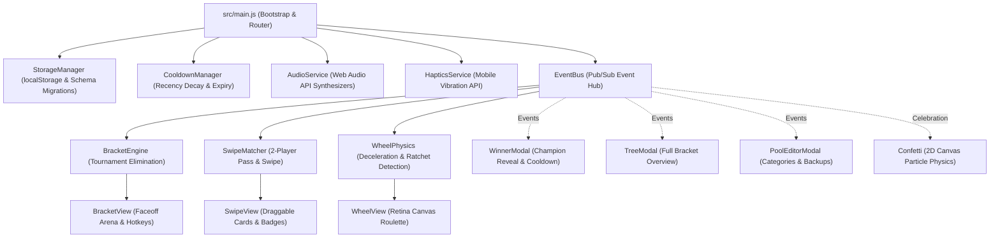

# IndecisionBracket

A premium, free, non-commercial, browser-based decision engine and tournament bracket built from scratch as a personal hobby project using pure HTML5 Canvas, modern CSS3, and modular ES6 JavaScript (with procedural Web Audio API sound synthesis and zero runtime dependencies).

Designed to eliminate everyday dinner and weekend indecision (*"What do we want to eat?"* / *"What movie should we watch?"*) through head-to-head elimination brackets, 2-player pass-and-swipe matching, and weighted roulette physics.

---

## Table of Contents

1. [Quick Start (Local Development)](#quick-start-local-development)
2. [Running Automated Unit Tests](#running-automated-unit-tests)
3. [How the Architecture Works](#how-the-architecture-works)
4. [Core Decision Modes](#core-decision-modes)
5. [The Cooldown & Recency Memory Engine](#the-cooldown--recency-memory-engine)
6. [Legal, IP & Non-Commercial Status](#legal-ip--non-commercial-status)

---

## Quick Start (Local Development)

The modular source code under `src/` is bundled into `app.js` via a zero-dependency bundler (`scripts/bundle.js`) so it works both by opening `index.html` directly (via `file://`) or over any local HTTP server:

```bash
# Bundle src/ -> app.js and run automated unit tests
npm test

# Start local preview server on port 8080
npm start
```

Then open `http://localhost:8080` in any modern desktop or mobile browser.

### Keyboard Shortcuts
- **Bracket Mode**: Press `1` or `◀` for Option A, `2` or `▶` for Option B, `Z` or `U` to Undo last pick.
- **Swipe Mode**: Press `▶` / `L` to Like, `◀` / `H` to Pass.
- **Wheel Mode**: Press `Spacebar` to Spin.

---

## Running Automated Unit Tests

The test suite uses Node's built-in test runner (`node:test` and `node:assert`) with zero external npm dependencies:

```bash
npm test
# or directly:
node --test tests/*.test.js
```

---

## How the Architecture Works

### 1. High-Level Event & Data Flow



### 2. Directory Layout

```text
indecision-bracket/
├── index.html                  # Semantic app shell, header pill, and bottom nav
├── style.css                   # Glassmorphic dark design system & responsive layout
├── app.js                      # Bundled single-file runtime (generated via npm run build)
├── manifest.webmanifest        # PWA Add-to-Home-Screen metadata
├── .nojekyll                   # GitHub Pages direct static hosting bypass
├── scripts/
│   └── bundle.js               # Zero-dependency ES module -> IIFE bundler
├── tests/
│   ├── bracket.test.js         # Automated tests for tournament progression & byes
│   ├── cooldown.test.js        # Automated tests for recency decay windows
│   ├── swipe.test.js           # Automated tests for 2-player mutual matching
│   └── storage.test.js        # Automated tests for schema migration & JSON backups
└── src/
    ├── main.js                 # App bootstrap, mode switcher & keyboard listeners
    ├── core/
    │   └── EventBus.js         # Decoupled pub/sub event router
    ├── domain/
    │   ├── BracketEngine.js    # Power-of-two & arbitrary pool tournament engine
    │   ├── SwipeMatcher.js     # 2-player pass-and-match logic
    │   ├── WheelPhysics.js     # Deceleration curve & angular velocity for wheel
    │   └── CooldownManager.js  # Recency decay filters & countdowns
    ├── storage/
    │   └── StorageManager.js   # LocalStorage persistence, default presets & JSON export
    ├── services/
    │   ├── AudioService.js     # Procedural Web Audio API sound synthesizers
    │   └── HapticsService.js   # Tactile mobile vibration
    └── ui/
        ├── BracketView.js      # Head-to-head match cards with hotkeys
        ├── SwipeView.js        # Physics-based draggable touch swipe cards
        ├── WheelView.js        # High-DPI Canvas roulette with ratchet ticks
        ├── WinnerModal.js      # Champion dialog with sharing & cooldown lock-in
        ├── TreeModal.js        # Visual tournament bracket tree
        ├── PoolEditorModal.js  # Category manager & JSON backup exporter
        └── Confetti.js         # Procedural 2D Canvas confetti particle burst
```

---

## Core Decision Modes

1. **🏆 Tournament Bracket:**
   - Compares items head-to-head two at a time (eliminating choice paralysis).
   - Dynamically supports any pool size (using automatic BYEs for non-power-of-two pools).
   - Features a 1-tap **Undo** button and full interactive bracket tree inspection.

2. **⚡ Duo Pass-and-Swipe ("Tinder for Decisions"):**
   - Player 1 swipes Right (Like) or Left (Pass) on favorite options.
   - Hands phone to Player 2, who swipes the deck.
   - **Instant Match**: As soon as Player 2 likes an option Player 1 also liked, the app instantly celebrates with confetti and fanfare!

3. **🎡 Canvas Roulette Wheel:**
   - High-DPI Canvas rendering with customizable sectors.
   - Realistic physical friction damping and angular deceleration.
   - Procedural Web Audio mechanical ratchet click that dynamically shifts pitch based on rotational speed.

---

## The Cooldown & Recency Memory Engine

A common flaw with randomizers is picking the same restaurant 3 days in a row. 

When a choice is crowned winner, tapping **"Lock In & Add Cooldown"** stamps the item with an active cooldown timestamp (configurable between 1 to 14 days, default 3 days). In subsequent sessions, cooled-down items are automatically sidelined so you always explore fresh options.

---

## Legal, IP & Non-Commercial Status

- **Original Code & Zero Runtime Dependencies**: 100% of the code, vector Canvas drawings, and sound synthesis oscillators (Web Audio API) are original and built from scratch. No third-party frameworks, cookies, fonts, or external assets are used.
- **Strictly Free & Non-Commercial (Personal Hobby & Portfolio Project)**:
  - **Zero Monetization**: This software is developed and hosted solely as a personal, unpaid coding and hobby utility. It generates **zero revenue** and contains no advertisements, no in-app purchases, no subscriptions, no tracking/telemetry, and no donation links of any kind.
  - **Local-Only Data Sovereignty**: All custom pools, preferences, and visit histories are stored strictly in the user's browser via `localStorage` (`indecision_bracket_v1`). Zero data ever leaves the device.
